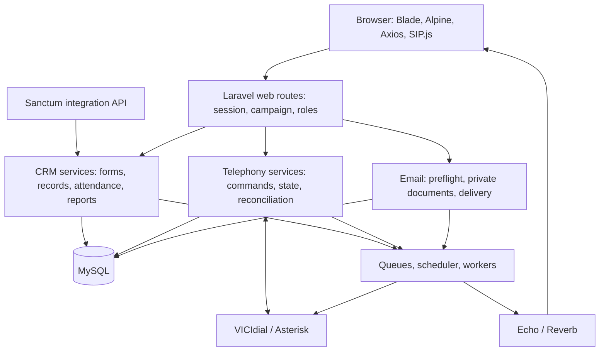

# Codebase Analysis and Improvement Report

**Project:** [Laravel CRM](C:/PyAMPP/bin/apache/Apache24/htdocs/laravel-crm)  
**Audit date:** October 26, 2026  
**Mode:** Read-only. No recommendations were implemented and no report files were created.

## Executive summary

The project has a viable Laravel architecture and substantial business functionality. Its strongest foundations include confidential-email safeguards, local telephony history synchronization, reusable form components, and deliberate preservation of active calls during navigation.

**The immediate priority is correctness and security at module boundaries.** The most significant findings are:

1. Public Operations Insights endpoints can disclose configured customer records.
2. Lead-edit requests can override the privileged VICIdial API operation.
3. Answer-event handlers request transitions rejected by the call-state machine.
4. Call creation and state changes lack sufficient concurrency protection.
5. Callback correlation can associate an event with the wrong call.
6. Dynamic-form validation, storage, and frontend visibility disagree.
7. The standalone capture page lacks its required Alpine initialization.
8. Dependency lockfiles contain known vulnerable versions.
9. CI uses PHP versions incompatible with parts of the committed lockfile.

**No application-level Critical exploit was demonstrated.** Upstream dependencies have Critical advisories, but their presence does not establish that this application exposes the affected functionality.

The recommended direction is to retain the monolith, strengthen its contracts, and simplify selected implementations incrementally. A framework replacement or microservices migration would add risk before addressing the verified defects.

## Scope and evidence

This was a project-wide inventory and targeted deep audit, including parallel reviews of telephony, CRM/data, and frontend behavior.

| Area | Files inventoried | Approximate lines |
|---|---:|---:|
| Application | 295 | 34,540 |
| Resources | 129 | 24,244 |
| Routes | 5 | 441 |
| Database | 86 | 3,744 |
| Configuration | 25 | 2,707 |
| Tests | 135 | 24,754 |
| Documentation | 149 | 16,900 |
| OpenSpec | 444 | 17,102 |

Other top-level directories—including deployment, patches, public assets, development tooling, generated output, storage, and installed dependencies—were inventoried and inspected where relevant.

Laravel Boost reported **PHP 8.5, Laravel 12.53.0, MySQL, and 64 database tables**.

Evidence labels used below:

- **Verified:** The implementation demonstrably contains the described defect or behavior.
- **Conditional risk:** The implementation is confirmed; harmful consequences require the stated circumstances.
- **Improvement:** A supported engineering recommendation without a demonstrated failure.

Effort estimates are relative: **Small**, **Medium**, or **Large**. Change risk describes the regression risk of remediation.

**Coverage limitation:** Not every source line was read. Generated bundles, dependency internals, binary artifacts, and large secondary modules were selectively inspected. This report does not claim exhaustive line-by-line coverage or production certification.

## Architecture assessment

### What works well

**The monolith fits the product.** Campaign configuration, forms, attendance, calls, and reporting share operational context. Keeping these together reduces deployment complexity and makes local transactional consistency achievable.

**The frontend preserves operational continuity.** Soft navigation retains the outer shell and phone widgets. That is appropriate for an application where navigation must not interrupt a call. Its lifecycle contract needs tightening, rather than wholesale replacement.

**Confidential email has useful safeguards.** Attachment validation, private encrypted storage, immutable manifests, recipient claims, and uncertain-outcome handling are visible in [EmailCampaignAttachmentService.php:18](C:/PyAMPP/bin/apache/Apache24/htdocs/laravel-crm/app/Services/EmailCampaignAttachmentService.php:18), [EmailCampaignPreflightService.php:85](C:/PyAMPP/bin/apache/Apache24/htdocs/laravel-crm/app/Services/EmailCampaignPreflightService.php:85), and [EmailCampaignDeliveryService.php:22](C:/PyAMPP/bin/apache/Apache24/htdocs/laravel-crm/app/Services/EmailCampaignDeliveryService.php:22).

**Historical telephony reads are moving toward durable local data.** Scoped synchronization, stable source identities, job uniqueness, and explicit freshness states are preferable to making every page depend on remote VICIdial availability.

### Main architectural weaknesses

- Critical invariants are enforced inconsistently across controllers, services, queues, and external callbacks.
- Dynamic forms combine metadata interpretation, validation, physical schema repair, reporting, and storage without one authoritative versioned contract.
- External commands do not consistently distinguish confirmed failure from an unknown outcome.
- Inline Blade component factories and imported JavaScript modules follow different initialization conventions.
- Tests are substantial, but important concurrency and actual-browser lifecycle boundaries remain under-tested.

Campaign selection currently establishes **context**, not per-user campaign membership: [CampaignService.php:39](C:/PyAMPP/bin/apache/Apache24/htdocs/laravel-crm/app/Services/CampaignService.php:39). Whether stronger campaign isolation is required is a business authorization decision; this audit does not assume that all cross-campaign access is unauthorized.

## Security findings

### S1 — High: Public reporting can expose customer records

**Verified behavior; exposure depends on deployment and populated fields.**

[web.php:21](C:/PyAMPP/bin/apache/Apache24/htdocs/laravel-crm/routes/web.php:21) registers Operations Insights and its JSON endpoints outside authentication. [OperationsInsightsController.php:181](C:/PyAMPP/bin/apache/Apache24/htdocs/laravel-crm/app/Http/Controllers/OperationsInsightsController.php:181) retrieves Data Master records, builds columns from form configuration, and returns their values.

The administrative field layout therefore also determines public disclosure. Existing storage includes customer and account-related fields, while [OperationsInsightsTest.php:127](C:/PyAMPP/bin/apache/Apache24/htdocs/laravel-crm/tests/Feature/OperationsInsightsTest.php:127) explicitly expects guest access to customer data.

**Impact:** A reachable endpoint can disclose individual customer records.

**Recommendation:** Require authentication and a records/report policy. If public reporting is intentional, use a separate approved aggregate projection with an explicit field allowlist.

**Effort:** Medium. **Change risk:** Medium.

### S2 — High: Lead requests can override privileged remote API operations

**Verified defect; no remote exploitation attempted.**

[LeadController.php:74](C:/PyAMPP/bin/apache/Apache24/htdocs/laravel-crm/app/Http/Controllers/Api/LeadController.php:74) and line 81 pass all request input to the service. [LeadService.php:49](C:/PyAMPP/bin/apache/Apache24/htdocs/laravel-crm/app/Services/Telephony/LeadService.php:49) preserves those extra parameters. [VicidialNonAgentApiService.php:75](C:/PyAMPP/bin/apache/Apache24/htdocs/laravel-crm/app/Services/Telephony/VicidialNonAgentApiService.php:75) merges them after `function`, `user`, `pass`, and `source`.

An authenticated caller with lead-tool access can replace `function` while retaining server credentials. Available remote operations depend on the configured account’s privileges.

**Recommendation:** Pass explicitly allowlisted validated fields; make transport-reserved keys immutable; authorize each operation separately. Apply the same reserved-key protection to the Agent API transport.

**Effort:** Medium. **Change risk:** Medium.

### S3 — High: Transport exceptions can place credentials in logs

**Verified leakage path; existing log contents were not inspected for secrets.**

[VicidialProxyService.php:70](C:/PyAMPP/bin/apache/Apache24/htdocs/laravel-crm/app/Services/Telephony/VicidialProxyService.php:70) puts credentials into a URL query, then logs raw exception messages at lines 105 and 115. [TelephonyLogger.php:39](C:/PyAMPP/bin/apache/Apache24/htdocs/laravel-crm/app/Services/Telephony/TelephonyLogger.php:39) forwards context without redaction.

The installed Guzzle handler appends the request URI to connection-error messages: [CurlFactory.php:268](C:/PyAMPP/bin/apache/Apache24/htdocs/laravel-crm/vendor/guzzlehttp/guzzle/src/Handler/CurlFactory.php:268). User-info redaction does not remove query-string passwords.

**Recommendation:** Centralize secret/PII redaction, including URLs and exception text. Reuse the safer classification/redaction approach already present in the Non-Agent transport. Review retained logs through an authorized operational process.

**Effort:** Small–Medium. **Change risk:** Low.

### S4 — High: Missing webhook secrets are accepted outside `production`

**Conditional security risk.**

[VicidialEventsWebhookController.php:36](C:/PyAMPP/bin/apache/Apache24/htdocs/laravel-crm/app/Http/Controllers/Api/VicidialEventsWebhookController.php:36) and [AmiWebhookController.php:32](C:/PyAMPP/bin/apache/Apache24/htdocs/laravel-crm/app/Http/Controllers/Api/AmiWebhookController.php:32) reject absent secrets only when the environment is exactly `production`. Their routes are unauthenticated and CSRF-exempt.

**Impact:** A reachable staging, development, or misnamed production instance can accept unauthenticated state-changing events.

**Recommendation:** Fail closed whenever integration authentication is missing. Allow synthetic unauthenticated events only through an explicit isolated test mechanism. Add source authentication, freshness, and replay controls where supported.

**Effort:** Medium. **Change risk:** Medium.

### S5 — Medium: Public health requests trigger expensive diagnostics

**Verified behavior; denial-of-service impact is unmeasured.**

[web.php:58](C:/PyAMPP/bin/apache/Apache24/htdocs/laravel-crm/routes/web.php:58) exposes telephony health without authentication or route throttling. [TelephonyHealthService.php:28](C:/PyAMPP/bin/apache/Apache24/htdocs/laravel-crm/app/Services/Telephony/TelephonyHealthService.php:28) performs multiple queries and a remote probe with a five-second timeout.

**Recommendation:** Separate cheap public liveness from protected diagnostics. Cache diagnostic snapshots, throttle access, and avoid remote probes on every public request.

**Effort:** Small–Medium. **Change risk:** Low.

### S6 — Medium: Security headers remain largely observational

**Verified configuration; defense-in-depth improvement.**

[SecurityHeaders.php:18](C:/PyAMPP/bin/apache/Apache24/htdocs/laravel-crm/app/Http/Middleware/SecurityHeaders.php:18) sets a report-only CSP allowing arbitrary HTTP/HTTPS script sources and inline scripts. It does not enforce the listed framing restrictions. [reverb.php:85](C:/PyAMPP/bin/apache/Apache24/htdocs/laravel-crm/config/reverb.php:85) accepts all origins.

**Recommendation:** Introduce an enforced CSP incrementally, with explicit telephony/frame/connect origins and a compatible Alpine strategy. Restrict Reverb origins to intended applications. Validate embedded workflows before enforcement.

**Effort:** Medium–Large. **Change risk:** Medium.

## Dependencies and runtime compatibility

### D1 — High: Both lockfiles contain known vulnerable versions

**Verified advisory matches; application exploitability varies.**

The read-only Composer audit returned **48 advisory entries across 13 packages**. Some entries overlap, so this is not 48 distinct exploitable application vulnerabilities.

| Locked package | Version | Advisory entries |
|---|---:|---:|
| Laravel framework | 12.53.0 | 6 |
| Guzzle | 7.10.0 | 9 |
| Guzzle PSR-7 | 2.8.0 | 4 |
| CommonMark | 2.8.0 | 14 |
| Flysystem | 3.32.0 | 1 |
| sodium_compat | 2.5.0 | 1 |
| Symfony HttpFoundation | 7.4.6 | 2 |
| Symfony HttpKernel | 7.4.6 | 1 |
| Symfony Mailer | 7.4.6 | 1 |
| Symfony Mime | 7.4.6 | 2 |
| Symfony Intl IDN polyfill | 1.33.0 | 1 |
| Symfony Routing | 7.4.6 | 2 |
| Symfony YAML | 8.0.6 | 4 |

Examples have direct relevance to the project’s HTTP/email stack: Laravel’s email-validation advisory and Symfony Mime’s address handling advisory. [Laravel advisory](https://github.com/laravel/framework/security/advisories/GHSA-5vg9-5847-vvmq), [Symfony advisory](https://symfony.com/cve-2026-45067).

Laravel also has a Critical TokenGuard advisory. The inspected authentication configuration uses a session guard and Sanctum, so that specific vulnerable guard was **not found enabled**. [TokenGuard advisory](https://github.com/laravel/framework/security/advisories/GHSA-f9x3-7vq9-cph6).

A direct npm registry advisory query, checked against locked versions using semver, returned **100 matching advisory records across 22 package names**:

`@modelcontextprotocol/sdk`, `axios`, `body-parser`, `brace-expansion`, `esbuild`, `fast-uri`, `follow-redirects`, `form-data`, `hono`, `ip-address`, `picomatch`, `nanoid`, `postcss`, `postcss-selector-parser`, `proxy-addr`, `shell-quote`, `socket.io-parser`, `source-map-js`, `undici`, `vite`, `ws`, and `zod`.

These include build/development tooling and transitive CLI dependencies; they should not all be described as shipped browser vulnerabilities. Vite 7.3.1 nevertheless matches a Windows file-access advisory relevant to this development environment. [Vite advisory](https://github.com/vitejs/vite/security/advisories/GHSA-fx2h-pf6j-xcff).

**References:** [composer.lock:1233](C:/PyAMPP/bin/apache/Apache24/htdocs/laravel-crm/composer.lock:1233), [package-lock.json:2067](C:/PyAMPP/bin/apache/Apache24/htdocs/laravel-crm/package-lock.json:2067), [package-lock.json:6091](C:/PyAMPP/bin/apache/Apache24/htdocs/laravel-crm/package-lock.json:6091).

**Recommendation:** Upgrade in bounded groups, rerun audits, and validate telephony parsing, mail addressing, signed URLs, HTTP failures, and asset builds. Prioritize reachable production paths and exposed development servers.

**Effort:** Medium–Large. **Change risk:** Medium–High.

### D2 — High: Declared PHP support and CI conflict with the lockfile

**Verified incompatibility.**

[composer.json:9](C:/PyAMPP/bin/apache/Apache24/htdocs/laravel-crm/composer.json:9) declares PHP `^8.2`, and [ci.yml:17](C:/PyAMPP/bin/apache/Apache24/htdocs/laravel-crm/.github/workflows/ci.yml:17) tests PHP 8.2/8.3. Locked Symfony packages require PHP 8.4+, including [composer.lock:4910](C:/PyAMPP/bin/apache/Apache24/htdocs/laravel-crm/composer.lock:4910).

**Impact:** Normal locked installation on the declared CI matrix cannot satisfy platform requirements.

**Recommendation:** Establish the supported PHP baseline, align manifest/CI/documentation, and test the actual deployment runtime. Avoid suppressing platform failures.

**Effort:** Small–Medium. **Change risk:** Low–Medium.

### D3 — Medium: Node’s declared minimum is too permissive

**Verified mismatch.**

[package.json:6](C:/PyAMPP/bin/apache/Apache24/htdocs/laravel-crm/package.json:6) allows Node 20.0+, while locked Vite and Laravel Vite Plugin require `^20.19.0 || >=22.12.0`: [package-lock.json:6110](C:/PyAMPP/bin/apache/Apache24/htdocs/laravel-crm/package-lock.json:6110).

**Recommendation:** Align `engines`, `.nvmrc`, CI, and setup documentation with the supported locked toolchain.

**Effort:** Small. **Change risk:** Low.

### D4 — Medium: Production patch application is not self-contained

**Conditional deployment risk; installed parser currently works.**

The PAMI compatibility patch is declared in [composer.json:88](C:/PyAMPP/bin/apache/Apache24/htdocs/laravel-crm/composer.json:88), but its patch plugin is a development dependency at line 24. A fresh `--no-dev` installation cannot rely on that plugin being available.

The installed parser contains the corrected `implode` call and successfully parsed a synthetic Hangup event during this audit.

**Recommendation:** Make patching part of a reproducible release-artifact procedure, or use a maintained compatible dependency. Verify the resulting artifact rather than editing vendor files manually.

**Effort:** Medium. **Change risk:** Medium.

### D5 — Low: Dependency constraints and unused tooling increase maintenance burden

**Verified warnings; removal candidates require confirmation.**

Composer strict validation warns about the wildcard Pusher dependency and exact CSS Selector/TCPDF constraints: [composer.json:17](C:/PyAMPP/bin/apache/Apache24/htdocs/laravel-crm/composer.json:17).

No application references were located for several React/shadcn-related packages in [package.json:28](C:/PyAMPP/bin/apache/Apache24/htdocs/laravel-crm/package.json:28). Their presence is installation/audit overhead, not proof they enter the production bundle.

**Recommendation:** Use intentional supported constraints and remove unused packages only after checking external tooling use.

**Effort:** Small–Medium. **Change risk:** Low–Medium.

## Telephony correctness and reliability

### T1 — High: Answer handlers request invalid state transitions

**Verified defect.**

[CallStateService.php:23](C:/PyAMPP/bin/apache/Apache24/htdocs/laravel-crm/app/Services/Telephony/CallStateService.php:23) permits dialing/ringing → answered, but not dialing/ringing → in_call. [AmiWebhookController.php:140](C:/PyAMPP/bin/apache/Apache24/htdocs/laravel-crm/app/Http/Controllers/Api/AmiWebhookController.php:140) and [VicidialEventsWebhookController.php:97](C:/PyAMPP/bin/apache/Apache24/htdocs/laravel-crm/app/Http/Controllers/Api/VicidialEventsWebhookController.php:97) request in_call directly.

**Impact:** Answer events can be rejected, leaving a connected call eligible for a no-answer timeout.

**Recommendation:** Normalize answer events through one atomic domain operation. Handle failed transition results explicitly and test both dialing and ringing entry states.

**Effort:** Small–Medium. **Change risk:** Medium.

### T2 — High: Stale models can overwrite terminal call state

**Verified missing concurrency protection; race not load-reproduced.**

[CallStateService.php:84](C:/PyAMPP/bin/apache/Apache24/htdocs/laravel-crm/app/Services/Telephony/CallStateService.php:84) checks the supplied model before entering the transaction, then saves without a persisted-state comparison or row lock at line 136.

**Impact:** Two workers holding different stale instances can overwrite a newer terminal transition.

**Recommendation:** Reload and lock inside the transaction, then validate the persisted state; alternatively use versioned compare-and-swap. Emit events only after successful persistence.

**Effort:** Medium. **Change risk:** Medium.

### T3 — High: “One active call” is not enforced atomically

**Verified race window.**

[CallOrchestrationService.php:35](C:/PyAMPP/bin/apache/Apache24/htdocs/laravel-crm/app/Services/Telephony/CallOrchestrationService.php:35) checks active state before a separate session-creation transaction at line 76.

**Impact:** Concurrent requests can both pass and issue separate remote dial commands.

**Recommendation:** Serialize initiation per agent, recheck inside that boundary, and use durable command idempotency keys.

**Effort:** Medium. **Change risk:** Medium.

### T4 — High: Callback correlation can update the wrong call

**Verified matching defects.**

[VicidialCallUrlService.php:396](C:/PyAMPP/bin/apache/Apache24/htdocs/laravel-crm/app/Services/Telephony/VicidialCallUrlService.php:396) first searches call IDs globally, then falls back to the latest campaign session when no match exists. A callback with an unknown authoritative ID can therefore match an unrelated call.

Separately, [VicidialEventsWebhookController.php:134](C:/PyAMPP/bin/apache/Apache24/htdocs/laravel-crm/app/Http/Controllers/Api/VicidialEventsWebhookController.php:134) closes the user’s latest active session without correlating the originating call; its counter is read but unused.

**Recommendation:** Match source/server, campaign, and call identity together. Quarantine unmatched authoritative IDs; persist event sequence/deduplication information and reject stale previous-call events.

**Effort:** Medium–Large. **Change risk:** Medium.

### T5 — High: Non-idempotent remote writes are automatically retried

**Verified retry policy; duplicate outcome is conditional.**

[VicidialNonAgentApiService.php:84](C:/PyAMPP/bin/apache/Apache24/htdocs/laravel-crm/app/Services/Telephony/VicidialNonAgentApiService.php:84) retries all functions, including `add_lead` from [LeadService.php:56](C:/PyAMPP/bin/apache/Apache24/htdocs/laravel-crm/app/Services/Telephony/LeadService.php:56).

**Impact:** A successful remote write followed by a lost response can be repeated.

**Recommendation:** Classify retry safety by operation. Reconcile ambiguous writes before replay unless the remote API supports reliable idempotency.

**Effort:** Small–Medium. **Change risk:** Low–Medium.

### T6 — Medium: A transport timeout becomes a definitive dial failure

**Conditional duplicate-call risk.**

[CallOrchestrationService.php:114](C:/PyAMPP/bin/apache/Apache24/htdocs/laravel-crm/app/Services/Telephony/CallOrchestrationService.php:114) marks the session failed when the transport reports failure, including timeouts.

**Impact:** VICIdial may have accepted the call while the CRM permits a fresh dial.

**Recommendation:** Separate confirmed rejection from unknown outcome. Preserve a reconcilable operational state until remote status establishes what happened.

**Effort:** Medium. **Change risk:** Medium.

### T7 — Medium: Important remote synchronization is not durable

**Verified design limitation.**

[SyncVicidialDispositionJob.php:17](C:/PyAMPP/bin/apache/Apache24/htdocs/laravel-crm/app/Jobs/SyncVicidialDispositionJob.php:17) and [SyncVicidialLeadFieldsJob.php:18](C:/PyAMPP/bin/apache/Apache24/htdocs/laravel-crm/app/Jobs/SyncVicidialLeadFieldsJob.php:18) use one attempt and the deferred connection.

**Impact:** Process termination or remote failure can permanently lose synchronization intent after local storage succeeds.

**Recommendation:** Persist an outbox/sync record with the local change and consume it through a managed durable queue with visible reconciliation status.

**Effort:** Medium–Large. **Change risk:** Medium.

### T8 — Medium: Reconciliation acknowledges unsuccessful processing

**Verified defect and duplication.**

[TelephonyReconciliationService.php:96](C:/PyAMPP/bin/apache/Apache24/htdocs/laravel-crm/app/Services/Telephony/TelephonyReconciliationService.php:96) marks events processed without checking `recordHangup()`’s result. [ReconcileCallStateJob.php:87](C:/PyAMPP/bin/apache/Apache24/htdocs/laravel-crm/app/Jobs/ReconcileCallStateJob.php:87) repeats the logic.

**Recommendation:** Make the job call one canonical service. Acknowledge only successful transitions; retain failed events with retry/error metadata.

**Effort:** Small–Medium. **Change risk:** Low–Medium.

### T9 — Medium: Live call durations can be negative

**Verified with an isolated Carbon calculation.**

[CallController.php:87](C:/PyAMPP/bin/apache/Apache24/htdocs/laravel-crm/app/Http/Controllers/Api/CallController.php:87) and [SupervisorOperationalService.php:188](C:/PyAMPP/bin/apache/Apache24/htdocs/laravel-crm/app/Services/Telephony/SupervisorOperationalService.php:188) calculate `now()->diffInSeconds(answered_at)`. Installed Carbon returned `-30` for an answer thirty seconds earlier.

**Recommendation:** Calculate elapsed time in the intended direction, define signed semantics, and clamp invalid future timestamps.

**Effort:** Small. **Change risk:** Low.

### T10 — Medium: Supervisor selection retains the oldest duplicate session

**Verified conditional selection defect.**

[SupervisorOperationalService.php:128](C:/PyAMPP/bin/apache/Apache24/htdocs/laravel-crm/app/Services/Telephony/SupervisorOperationalService.php:128) sorts newest first, then uses `keyBy('user_id')`, which retains the last duplicate.

**Impact:** Users with multiple matching sessions can display stale status/campaign information.

**Recommendation:** Select latest-per-user in SQL or group and take the first descending result.

**Effort:** Small. **Change risk:** Low.

## Forms, database integrity, and business data

### C1 — High: Hidden required fields prevent legitimate submissions

**Verified frontend/backend disagreement.**

[FormSubmissionRequest.php:29](C:/PyAMPP/bin/apache/Apache24/htdocs/laravel-crm/app/Http/Requests/FormSubmissionRequest.php:29) requires configured fields without evaluating visibility. [FormSubmissionService.php:166](C:/PyAMPP/bin/apache/Apache24/htdocs/laravel-crm/app/Services/FormSubmissionService.php:166) repeats that requirement.

The UI disables hidden controls in [forms/_content.blade.php:172](C:/PyAMPP/bin/apache/Apache24/htdocs/laravel-crm/resources/views/forms/_content.blade.php:172); [form-visibility.js:298](C:/PyAMPP/bin/apache/Apache24/htdocs/laravel-crm/resources/js/form-visibility.js:298) omits disabled values.

**Recommendation:** Define one visibility/validation contract, evaluate it server-side, and require only applicable fields. Do not trust client-supplied visibility flags.

**Effort:** Medium. **Change risk:** Medium.

### C2 — High: Interrupted imports can duplicate committed rows

**Verified replay defect under interruption/retry.**

[ImportLeadsCsvJob.php:21](C:/PyAMPP/bin/apache/Apache24/htdocs/laravel-crm/app/Jobs/ImportLeadsCsvJob.php:21) allows two attempts. Each attempt restarts the file at line 73. [FormSubmissionService.php:67](C:/PyAMPP/bin/apache/Apache24/htdocs/laravel-crm/app/Services/FormSubmissionService.php:67) commits each row independently and generates a fresh request ID.

**Recommendation:** Introduce stable import-row identity and checkpointed chunks, with atomic progress/results. Test interruption after several committed rows and subsequent replay.

**Effort:** Medium–Large. **Change risk:** Medium.

### C3 — Medium: Numeric normalization silently corrupts valid values

**Verified deterministic defect.**

[FormSubmissionRequest.php:58](C:/PyAMPP/bin/apache/Apache24/htdocs/laravel-crm/app/Http/Requests/FormSubmissionRequest.php:58) accepts numeric values, but [FormSubmissionService.php:156](C:/PyAMPP/bin/apache/Apache24/htdocs/laravel-crm/app/Services/FormSubmissionService.php:156) strips everything except digits and periods.

Examples: `-12.50` becomes `12.50`; `1e3` becomes `13`.

**Recommendation:** Preserve validated decimal semantics or explicitly reject unsupported formats. Define precision, range, and rounding rules; review whether existing records need reconciliation.

**Effort:** Small. **Change risk:** Medium.

### C4 — Medium: Editing form identity disconnects metadata

**Verified update defect.**

[UpdateFormRequest.php:21](C:/PyAMPP/bin/apache/Apache24/htdocs/laravel-crm/app/Http/Requests/Admin/UpdateFormRequest.php:21) permits changing campaign, form code, and table. [FormsController.php:104](C:/PyAMPP/bin/apache/Apache24/htdocs/laravel-crm/app/Http/Controllers/Admin/FormsController.php:104) updates the form without migrating independently keyed field metadata.

**Impact:** Renames/moves can disconnect validation, fields, historical references, and capture mappings.

**Recommendation:** Make identifiers immutable after use, or implement an explicit transactional migration covering all references and both campaigns’ cache invalidation.

**Effort:** Medium. **Change risk:** Medium–High.

### C5 — Medium: Data Master updates bypass normal field validation

**Verified validation gap.**

[DataMasterController.php:116](C:/PyAMPP/bin/apache/Apache24/htdocs/laravel-crm/app/Http/Controllers/Admin/DataMasterController.php:116) accepts physical columns except a small exclusion list and writes request values without the normal dynamic field rules.

**Impact:** Authorized editors can introduce invalid values or alter provenance fields such as agent/request identifiers.

**Recommendation:** Define editable fields explicitly, protect provenance, and share typed validation across create/edit/import paths. Make intentional privileged overrides explicit and audited.

**Effort:** Medium. **Change risk:** Medium.

### C6 — Medium: Attendance has concurrency and overnight-state defects

**Verified defects.**

[AttendanceStatusService.php:30](C:/PyAMPP/bin/apache/Apache24/htdocs/laravel-crm/app/Services/AttendanceStatusService.php:30) checks open state before its transaction. The lookup at line 100 is restricted to today.

**Impact:** Concurrent requests can create overlapping segments; a status begun before midnight can become invisible and uncloseable through the same service.

**Recommendation:** Lock a stable per-user state boundary and reconstruct open status across the active session, including overnight shifts.

**Effort:** Medium. **Change risk:** Medium.

### C7 — Medium: Ordinary submissions perform physical schema repair

**Verified architecture/availability risk; contention unmeasured.**

[FormSubmissionService.php:59](C:/PyAMPP/bin/apache/Apache24/htdocs/laravel-crm/app/Services/FormSubmissionService.php:59) performs storage preparation before its transaction/error handling. Methods beginning at line 183 can create or alter storage structures. Imports repeat this path per row.

**Impact:** Request latency includes schema introspection; drift can trigger DDL, lock contention, concurrent provisioning races, and a requirement for broad database privileges.

**Recommendation:** Provision versioned schema during administrative configuration publication or deployment. Keep submission paths DML-only with a lightweight schema-version check.

**Effort:** Large. **Change risk:** High. Preserve existing nullability protections during migration.

### C8 — Medium: CSV exports lack spreadsheet-formula protection

**Verified missing protection; evaluation depends on spreadsheet behavior.**

[ExtractionService.php:80](C:/PyAMPP/bin/apache/Apache24/htdocs/laravel-crm/app/Services/ExtractionService.php:80) and [CaptureRecordsController.php:136](C:/PyAMPP/bin/apache/Apache24/htdocs/laravel-crm/app/Http/Controllers/Admin/CaptureRecordsController.php:136) pass stored text to CSV output without formula-safe encoding.

**Recommendation:** Use one export encoder that distinguishes genuine numeric values from untrusted text. Consider typed XLSX cells when exact display fidelity matters.

**Effort:** Small–Medium. **Change risk:** Low–Medium.

### C9 — Medium: Unexpected exception details reach users

**Verified error-path disclosure.**

[FormSubmissionService.php:100](C:/PyAMPP/bin/apache/Apache24/htdocs/laravel-crm/app/Services/FormSubmissionService.php:100) returns raw exception messages; [FormController.php:76](C:/PyAMPP/bin/apache/Apache24/htdocs/laravel-crm/app/Http/Controllers/FormController.php:76) exposes them through responses. Similar propagation exists in disposition/history services.

**Recommendation:** Separate expected validation failures from infrastructure errors. Return safe messages and correlation IDs; record sanitized details internally.

**Effort:** Small–Medium. **Change risk:** Low.

### C10 — Medium: A historical migration irreversibly removes unregistered columns

**Conditional upgrade/recovery risk, not evidence of unauthorized current deletion.**

[2026_08_05_080950_cleanup_unregistered_form_columns.php:65](C:/PyAMPP/bin/apache/Apache24/htdocs/laravel-crm/database/migrations/2026_08_05_080950_cleanup_unregistered_form_columns.php:65) drops unregistered columns and indexes; `down()` is empty at line 84.

**Recommendation:** For environments where it remains pending, inspect affected data and verify backup restoration before upgrading. Use explicit reviewed data-retirement procedures for future destructive changes. Do not rewrite an already-applied migration casually.

**Effort:** Small for preflight; larger for redesign. **Change risk:** High if executed without recovery preparation.

## Frontend, accessibility, and UX consistency

### F1 — High: Standalone capture page does not initialize Alpine

**Verified entrypoint defect; browser reproduction not performed.**

[capture_webform.blade.php:15](C:/PyAMPP/bin/apache/Apache24/htdocs/laravel-crm/resources/views/agent/capture_webform.blade.php:15) loads only [agent-capture-webform-entry.js:1](C:/PyAMPP/bin/apache/Apache24/htdocs/laravel-crm/resources/js/agent-capture-webform-entry.js:1). Its imports do not start Alpine, while the document relies on Alpine directives and `x-cloak`.

**Impact:** Configured fields remain hidden and interactive submission is not initialized.

**Recommendation:** Initialize Alpine once in the dedicated entrypoint, preserving its lightweight scope. Test the actual iframe document’s visibility, conditions, and submission.

**Effort:** Small–Medium. **Change risk:** Low.

### F2 — High: Duplicate Alpine initialization leaks timers and handlers

**Verified lifecycle defect.**

[agent/index.blade.php:9](C:/PyAMPP/bin/apache/Apache24/htdocs/laravel-crm/resources/views/agent/index.blade.php:9) combines an automatically invoked `init()` with `x-init="init()"`. Setup at line 402 registers timers and handlers; cleanup at line 495 retains only overwritten references.

The same pattern exists in reports, supervisor, and shared widgets.

**Impact:** Duplicate polling and stale shortcut handlers can accumulate, particularly across soft navigation.

**Recommendation:** Standardize on Alpine’s automatic lifecycle, make setup idempotent, and ensure complete teardown. Measure request/handler counts across repeated navigation.

**Effort:** Medium. **Change risk:** Medium.

### F3 — Medium: Optional browser storage can stop essential startup

**Verified failure path.**

[app.js:289](C:/PyAMPP/bin/apache/Apache24/htdocs/laravel-crm/resources/js/app.js:289) parses stored JSON without protection before Alpine starts.

**Trigger:** Corrupt JSON or denied storage access.

**Recommendation:** Centralize guarded storage access, validate stored shapes, and fall back safely. Optional preferences must not block forms or call controls.

**Effort:** Small. **Change risk:** Low.

### F4 — Medium: User-edit submission raises a JavaScript error

**Verified defect.**

[users.blade.php:93](C:/PyAMPP/bin/apache/Apache24/htdocs/laravel-crm/resources/views/admin/users.blade.php:93) assigns `.name` to the return value of `prepend()`, which is `undefined`.

**Impact:** The edit marker is not established, a client error occurs, and validation recovery cannot reliably reopen the edited row. Native submission may still proceed.

**Recommendation:** Render a normal hidden `_editing` input.

**Effort:** Small. **Change risk:** Low.

### F5 — Medium: Repeated form components generate duplicate IDs

**Verified accessibility defect.**

[input.blade.php:16](C:/PyAMPP/bin/apache/Apache24/htdocs/laravel-crm/resources/views/components/form/input.blade.php:16) derives IDs solely from field names. Create and repeated edit forms use the same names in [users.blade.php:97](C:/PyAMPP/bin/apache/Apache24/htdocs/laravel-crm/resources/views/admin/users.blade.php:97). Select/textarea/checkbox components follow similar conventions.

**Impact:** Labels, error descriptions, and password-manager associations become ambiguous.

**Recommendation:** Support explicit IDs or a form/row prefix and propagate the unique ID consistently.

**Effort:** Small–Medium. **Change risk:** Low.

### F6 — Medium: Soft navigation omits Activity Log styles

**Verified asset-lifecycle mismatch.**

[activity_log.blade.php:168](C:/PyAMPP/bin/apache/Apache24/htdocs/laravel-crm/resources/views/admin/activity_log.blade.php:168) pushes styles into the document head. [soft-navigate.js:282](C:/PyAMPP/bin/apache/Apache24/htdocs/laravel-crm/resources/js/soft-navigate.js:282) replaces only the main content; its asset loader copies scripts.

**Impact:** Direct loading and soft entry can render differently, including missing responsive/overflow rules.

**Recommendation:** Move these styles into versioned assets or implement scoped page-asset loading.

**Effort:** Small. **Change risk:** Low.

### F7 — Medium: The Pusher branch is unreachable

**Verified conditional configuration defect.**

[echo.js:50](C:/PyAMPP/bin/apache/Apache24/htdocs/laravel-crm/resources/js/echo.js:50) returns when no key exists, then line 60 chooses Reverb whenever a key exists.

**Impact:** A Pusher-configured deployment receives Reverb settings instead.

**Recommendation:** Select the configured driver explicitly and validate its own credentials. Test both supported configurations.

**Effort:** Small. **Change risk:** Low–Medium.

### F8 — Medium: Customer drafts persist without expiry

**Verified retention behavior; privacy impact depends on workstation/data use.**

[form-visibility.js:547](C:/PyAMPP/bin/apache/Apache24/htdocs/laravel-crm/resources/js/form-visibility.js:547) includes user/campaign/lead/phone context in localStorage keys. Line 636 stores plaintext values; the reader at line 575 does not enforce expiry. Logout does not purge drafts.

**Recommendation:** Define retention, exclude sensitive fields, expire/purge drafts, and consider authenticated server-side drafts. User-scoped keys prevent accidental UI collisions but do not secure a shared browser profile.

**Effort:** Medium. **Change risk:** Medium.

## Operations, testing, and maintainability

### O1 — Medium: Two commands declare `ami:listen`

**Verified ambiguity.**

[AmiListenerCommand.php:16](C:/PyAMPP/bin/apache/Apache24/htdocs/laravel-crm/app/Console/Commands/AmiListenerCommand.php:16) and [AmiEventListenerCommand.php:26](C:/PyAMPP/bin/apache/Apache24/htdocs/laravel-crm/app/Console/Commands/AmiEventListenerCommand.php:26) share the name while implementing different event paths and options.

**Recommendation:** Choose one canonical implementation or distinct names. Align process-manager configuration and add a command-registration assertion.

**Effort:** Small–Medium. **Change risk:** Medium.

### O2 — Medium: Startup scripts omit queues and race migrations

**Verified script behavior.**

[start-dev.bat:16](C:/PyAMPP/bin/apache/Apache24/htdocs/laravel-crm/start-dev.bat:16) and [start-dev.sh:55](C:/PyAMPP/bin/apache/Apache24/htdocs/laravel-crm/start-dev.sh:55) consume only `telephony,default`, although imports use `imports` and legacy originate jobs use `asterisk`. Email requires its separate consumer.

Both scripts start application processes before migrations; the shell script suppresses migration failures at line 65.

**Recommendation:** Define explicit development service profiles, run migrations successfully before serving, and expose health for each enabled queue lane. Keep the dedicated email consumer explicit.

**Effort:** Medium. **Change risk:** Low–Medium.

### O3 — Medium: Coverage failure is allowed to fall back to an ungated pass

**Verified CI weakness.**

[ci.yml:62](C:/PyAMPP/bin/apache/Apache24/htdocs/laravel-crm/.github/workflows/ci.yml:62) runs coverage with a minimum, then reruns tests without that minimum if the first command fails.

The workflow also lacks frontend build/test jobs despite existing JavaScript tests. [package.json:8](C:/PyAMPP/bin/apache/Apache24/htdocs/laravel-crm/package.json:8) exposes only build/dev scripts.

**Recommendation:** Make coverage an intentional enforced gate; publish the generated artifact explicitly; add discoverable JavaScript tests and a reproducible asset build.

**Effort:** Medium. **Change risk:** Low.

### O4 — Medium: Test names overstate concurrency coverage

**Verified test limitation.**

[CallStateRaceConditionTest.php:46](C:/PyAMPP/bin/apache/Apache24/htdocs/laravel-crm/tests/Unit/Services/Telephony/CallStateRaceConditionTest.php:46) repeatedly operates on refreshed models sequentially. [HighLoadCallSimulationTest.php:28](C:/PyAMPP/bin/apache/Apache24/htdocs/laravel-crm/tests/Feature/Telephony/HighLoadCallSimulationTest.php:28) uses sequential loops.

**Recommendation:** Add stale-instance tests and multi-connection MySQL contention tests. Keep the existing lifecycle tests, but describe accurately what they establish.

**Effort:** Medium. **Change risk:** Low.

### O5 — Medium: Role authority is inconsistent

**Verified source inconsistency; stored pivot assignments were not audited.**

[CheckRole.php:21](C:/PyAMPP/bin/apache/Apache24/htdocs/laravel-crm/app/Http/Middleware/CheckRole.php:21) uses `users.role`; [EnsureTelephonyFeatureEnabled.php:16](C:/PyAMPP/bin/apache/Apache24/htdocs/laravel-crm/app/Http/Middleware/EnsureTelephonyFeatureEnabled.php:16) uses Spatie `hasRole()`. User administration writes the former without an observed role synchronization path.

**Recommendation:** Choose one authority and align helpers, middleware, policies, and provisioning. Test authorization using users created through the supported service.

**Effort:** Small–Medium. **Change risk:** Medium.

### O6 — Medium: Some observability paths discard useful failures

**Verified implementation gaps.**

[web.php:159](C:/PyAMPP/bin/apache/Apache24/htdocs/laravel-crm/routes/web.php:159) acknowledges client errors without recording them. [LogThrottleResponses.php:14](C:/PyAMPP/bin/apache/Apache24/htdocs/laravel-crm/app/Http/Middleware/LogThrottleResponses.php:14) expects a returned 429 response, whereas Laravel’s throttle middleware throws before reaching downstream middleware.

**Recommendation:** Record bounded, sanitized client-error telemetry and handle throttle logging at the exception/rendering boundary.

**Effort:** Small–Medium. **Change risk:** Low.

## Performance and simplification

### P1 — Medium: Reporting transfers and processes more rows than needed

**Verified patterns; production bottleneck magnitude unmeasured.**

[LocalCallHistoryQueryService.php:97](C:/PyAMPP/bin/apache/Apache24/htdocs/laravel-crm/app/Services/Telephony/LocalCallHistoryQueryService.php:97) loads all matching agent/status values before deduplication. Supervisor/realtime reporting materializes daily call collections, while large historical windows are loaded before local chunked writes.

**Recommendation:** Use SQL `distinct`, grouped aggregates, latest-per-user queries, and bounded/keyset-paged synchronization. Select indexes from measured query plans.

The inspected `call_sessions` table already has useful user/status, status/dialed-time, and identifier indexes. There is insufficient evidence to prescribe indiscriminate additional indexes.

**Effort:** Medium. **Change risk:** Medium.

### P2 — Medium: Email delivery repeats whole-campaign work per recipient

**Verified scaling pattern.**

[EmailCampaignDeliveryService.php:64](C:/PyAMPP/bin/apache/Apache24/htdocs/laravel-crm/app/Services/EmailCampaignDeliveryService.php:64) hashes/searches the campaign manifest for each recipient; line 161 recounts all recipient statuses.

**Impact:** Campaign processing can approach quadratic work as recipient count grows.

**Recommendation:** Preserve integrity guarantees while introducing immutable per-recipient verification data and incremental or periodically reconciled totals. Profile at the configured maximum recipient count first.

**Effort:** Medium–Large. **Change risk:** Medium–High.

### P3 — Low: Large combined services make changes expensive

**Verified maintainability concern.**

[DashboardStatsService.php:1247](C:/PyAMPP/bin/apache/Apache24/htdocs/laravel-crm/app/Services/DashboardStatsService.php:1247) contains several related per-record aggregation paths within an approximately 1,978-line class. Large historical-report, supervisor, and inline Blade implementations show similar concentration.

**Recommendation:** Extract shared rule evaluation, query construction, and result assembly behind existing interfaces, one behavior at a time. Avoid adding generic abstractions without a concrete repeated responsibility.

**Effort:** Large incrementally. **Change risk:** Medium–High.

## Prioritized recommendations

| Order | Work | Reason |
|---:|---|---|
| 1 | S1–S4: public data, API overrides, secrets, webhook authentication | Confidentiality and privileged-operation boundaries |
| 2 | D1–D2: security updates and supported PHP baseline | Known vulnerable versions and reproducible installation |
| 3 | T1–T4: valid, atomic, correctly correlated call state | Core operational correctness |
| 4 | F1–F2: capture bootstrap and lifecycle | Broken workflows and duplicated actions/load |
| 5 | C1–C3: conditional validation, imports, numeric preservation | Business-data accuracy |
| 6 | T5–T8: remote uncertainty and durable synchronization | Recovery from real network/process failures |
| 7 | O1–O6: service profiles, CI, roles, telemetry | Reliable development and operation |
| 8 | C4–C10, F3–F8, P1–P3 | Controlled integrity, UX, and scalability improvements |

## Quick wins

Small, focused changes with useful impact:

- Protect transport-reserved API keys.
- Correct elapsed-time direction and latest-session selection.
- Add the missing standalone Alpine bootstrap.
- Replace the broken `_editing` handler with a hidden input.
- Guard optional localStorage reads.
- Make field IDs unique.
- Correct Pusher driver selection.
- Move Activity Log styles into versioned assets.
- Align PHP/Node declarations and CI.
- Remove the coverage fallback that defeats the threshold.

Changes touching active-call lifecycle still warrant focused regression coverage even when the patch is small.

## Long-term improvements

1. **Version dynamic forms.** Treat metadata, validation, visibility, storage mapping, exports, and reporting as one published schema contract.
2. **Use durable command/sync records.** Track intent, attempts, remote identity, confirmed outcomes, and unresolved ambiguity.
3. **Standardize frontend lifecycle.** One initialization convention, explicit teardown, and scoped asset ownership.
4. **Separate public projections from administrative data models.**
5. **Make releases reproducible.** Supported runtimes, immutable lockfiles, verified patches, explicit queue consumers, and rehearsed recovery.
6. **Introduce static analysis gradually.** Pint verifies style; it does not replace type/flow analysis. Establish a manageable Larastan/PHPStan baseline after the immediate defects.
7. **Measure before optimizing.** Track query counts, examined rows, memory, queue lag, synchronization freshness, and browser polling rates.

The connected database also contains `sms_*` tables for which a matching SMS application module was not located in this checkout. This is an ownership/schema-inventory observation, not a recommendation to remove data.

## Phased implementation roadmap

| Phase | Scope | Acceptance criteria |
|---|---|---|
| **1 — Contain exposure** | S1–S4, D1–D2 | Guest records protected; reserved-key tests reject overrides; secrets redacted; webhooks fail closed; supported runtime installs and audits |
| **2 — Restore correctness** | T1–T4, C1–C3, F1–F2 | Valid answer flow; one active initiation under contention; stale events cannot affect newer calls; conditional forms and numeric values preserved; import replay creates no duplicates |
| **3 — Make recovery reliable** | T5–T8, O1–O6 | Unknown outcomes remain reconcilable; synchronization intent survives interruption; canonical listener and queue profiles; meaningful CI and telemetry |
| **4 — Consolidate contracts** | C4–C10, F3–F8 | Form identity/storage changes controlled; edits share validation; overnight attendance correct; exports safe; draft retention explicit |
| **5 — Scale with evidence** | P1–P3 | Representative workload benchmarks; bounded report/sync memory; reduced repeated aggregation; behavior-preserving service extraction |

Each phase should use a separate focused OpenSpec change and remain unarchived until its required tests and browser checks pass.

## Validation performed and limits

| Check | Result |
|---|---|
| PHP syntax checks | **536 files passed** |
| JavaScript syntax checks | **36 files passed** |
| Composer strict validation | Schema valid; **exit 1 from constraint warnings** |
| Composer advisory audit | **48 advisory entries, 13 packages** |
| npm registry advisory matching | **100 matching records, 22 package names** |
| Laravel Boost inspection | Application/package metadata and MySQL schema inspected |
| Isolated Carbon calculation | Confirmed negative elapsed-time result |
| Isolated PAMI parsing | Synthetic Hangup event parsed successfully |
| Git working-tree comparison | Only the pre-existing `skills-lock.json` modification remained |

**Not performed:** PHPUnit execution, JavaScript test execution, asset build, migrations, application navigation/login, browser interaction tests, contrast measurements, load tests, production process inspection, or live calls/messages.

Playwright had only an `about:blank` tab. Application navigation was avoided because requests can create sessions, logs, caches, and other state. Consequently, frontend findings are source-verified; rendered accessibility and responsive behavior remain unverified.

Repo-analyzer, OpenSpec exploration, Superpowers verification/debugging guidance, Impeccable source-review guidance, and Laravel Boost informed the audit. No Superpowers MCP was exposed. OpenSpec proposals, synchronization, and archival were not performed because this was an analysis-only request.

**Files changed by this audit: none.**