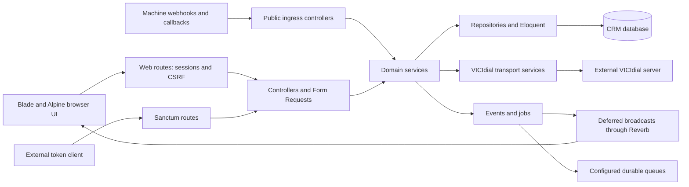

# Application architecture

Browser requests use session-based web middleware; the small Sanctum route family serves token clients. Controllers validate/delegate to services, which access persistence or external integration boundaries. Events support listeners, deferred broadcasts and explicit durable jobs. Public ingress has its own secret rules. Database/remote operations are not a distributed transaction. Source: bootstrap/app.php, routes, AppServiceProvider, services, events and jobs.
