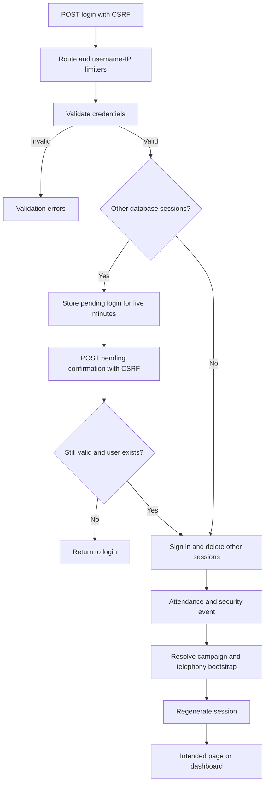

# Browser authentication

LoginController validates credentials before offering session takeover. Confirmation is time-limited. Finalization disables remember-me, logs attendance, resolves campaign, stores bootstrap data and regenerates the session. This diagram excludes Sanctum bearer authentication, which is a separate route boundary. Source: LoginController, LoginRequest and AuthService.
