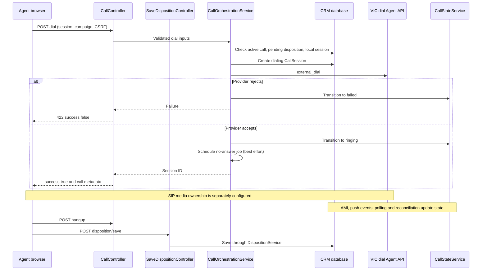

# Outbound call workflow

Dial acceptance is not an answered call or verified audio. Current orchestration invokes VICIdial directly rather than dispatching the legacy AMI originate job. A no-answer scheduling failure is logged without turning an already accepted remote dial into an immediate setup failure. State/correlation, hangup and disposition continue through separate requests/events. Source: CallController, CallOrchestrationService, CallStateService.
