# Verified model relationship map

```mermaid
erDiagram
    USERS ||--o{ CALL_SESSIONS : user_id
    USERS ||--o{ ATTENDANCE_LOGS : user_id
    USERS ||--o{ VICIDIAL_AGENT_SESSIONS : user_id
    USERS ||--o{ USER_WIDGET_LAYOUTS : user_id
    USERS ||--o{ NOTIFICATION_READ_STATES : user_id
    CALL_SESSIONS o|--o{ AGENT_CAPTURE_RECORDS : call_session_id
    USERS ||--o{ AGENT_CAPTURE_RECORDS : user_id
    CAMPAIGNS ||--o{ FORMS : campaign_code_to_code
    CAMPAIGNS ||--o{ FORM_FIELDS : campaign_code_to_code
    FORMS ||--o{ FORM_FIELDS : form_code_and_campaign
    FORMS ||--o| DATA_RETENTION_POLICIES : form_id
    CAMPAIGNS ||--o{ DISPOSITION_CODES : campaign_code_to_code
    CAMPAIGNS ||--o{ VICIDIAL_SERVERS : campaign_code_to_code
    CAMPAIGNS ||--o{ CAMPAIGN_VICIDIAL_MAPPINGS : campaign_id
    VICIDIAL_SERVERS ||--o{ CAMPAIGN_VICIDIAL_MAPPINGS : vicidial_server_id
    CAMPAIGNS ||--o{ TELEPHONY_CALL_HISTORIES : crm_campaign_id
    VICIDIAL_SERVERS ||--o{ TELEPHONY_CALL_HISTORIES : vicidial_server_id
    USERS o|--o{ TELEPHONY_CALL_HISTORIES : crm_user_id
    CAMPAIGNS ||--o{ VICIDIAL_CALL_HISTORY_SYNC_STATES : crm_campaign_id
    VICIDIAL_SERVERS ||--o{ VICIDIAL_CALL_HISTORY_SYNC_STATES : vicidial_server_id
    ATTENDANCE_STATUS_TYPES o|--o{ ATTENDANCE_LOGS : attendance_status_type_id
    EMAIL_TEMPLATES ||--o{ EMAIL_CAMPAIGNS : email_template_id
    EMAIL_CAMPAIGNS ||--o{ EMAIL_CAMPAIGN_RECIPIENTS : email_campaign_id
    EMAIL_CAMPAIGNS ||--o{ EMAIL_CAMPAIGN_DOCUMENTS : email_campaign_id
```

This selected model relationship diagram is not a full schema or foreign-key enforcement assertion. Cardinalities express model-side associations and optional references; existing orphaned data was not inspected. Many campaign associations use a string campaign code, while newer mapping/history associations use integer IDs. Form fields are additionally scoped by campaign when joined by form code. Dynamic form-data tables are intentionally not collapsed into an invented universal submission table. Source: app/Models and database/migrations. See [database guide](../developer/database.md).
