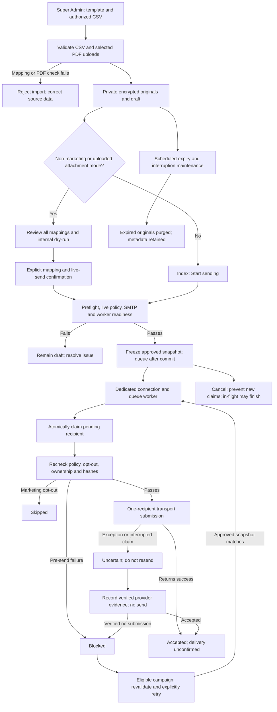

# Email campaign processing

This describes current source behavior, not proof that a worker or SMTP service is running. See the [canonical operator guide](../EMAIL_CAMPAIGNS.md) for constraints and incident handling.

## Equivalent text flow

1. A Super Admin configures a sender/transport and creates or imports a plain-text template. OCR creates editable text; it does not attach the original. Optional template-generated PDFs are separate from uploaded originals.
2. A campaign imports an authorized CSV and selected shared/personal PDF uploads. Strict manifests reject ambiguous mappings; PDF structure, policy and limits must pass before encrypted originals are stored privately. The operator must verify actual content ownership.
3. Non-marketing campaigns or any uploaded attachment mode require review of recipients, purpose, sender and documents, a matching internal dry-run, and explicit mapping/live-send confirmation. Marketing with upload mode `none` uses the simpler index Start sending action even when the template generates a PDF. Every campaign is preflighted and frozen at queue time.
4. Live policy, SMTP readiness and the dedicated consumer must pass. Local bulk sending additionally requires the local opt-in. The configured connection/queue defaults to `email-database` / `email-campaigns`. Jobs become eligible by batch delay; the worker processes recipient IDs independently. Generic campaigns use distributor batch jobs first.
5. A recipient is atomically claimed from pending to sending. Current policy, opt-outs for marketing, frozen ownership/content and PDF hashes are rechecked. Each message has one recipient with no CC/BCC; only shared documents and that recipient's personal document are attached, plus any generated template PDF.
6. Success becomes accepted (historical campaigns may say sent), which means transport acceptance only. Verification failure before transport becomes blocked; an exception after entering transport or an interrupted claim becomes uncertain. Opted-out marketing recipients become skipped. Cancellation stops new claims; an in-flight message can finish.
7. Review/report exposes redacted status information. A blocked recipient in an eligible needs-attention campaign can be explicitly retried after unchanged approved data passes preflight. Uncertain recipients require provider evidence: verified acceptance closes the outcome, while verified no-submission becomes blocked and still needs separate retry authorization. Reconciliation itself never sends.
8. Scheduled maintenance every five minutes purges expired originals, handles orphan/workspace cleanup and marks stale claims uncertain. Explicit `email-campaigns:maintain --recover` additionally redispatches pending IDs from frozen queued/sending campaigns. It never resends uncertain rows and is not read-only. Metadata/history/snapshots and backups need separate retention procedures.

## Diagram

Sources: [campaign actions](../../app/Http/Controllers/Admin/EmailCampaignsController.php), [preflight](../../app/Services/EmailCampaignPreflightService.php), [delivery](../../app/Services/EmailCampaignDeliveryService.php), [queue status](../../app/Services/EmailCampaignQueueStatus.php), [maintenance](../../app/Console/Commands/MaintainEmailCampaigns.php), [schedule](../../routes/console.php).
