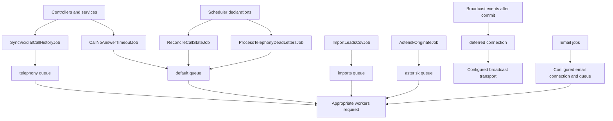

# Jobs and queues

Queues shown come from job constructors or explicit dispatch configuration. A queue name does not specify its backend connection. Broadcast event classes use the deferred connection and are distinct from durable jobs. Asterisk/import queues exist even though the default development command only listens to telephony/default; provision workers according to actual intended workloads. Email has dedicated connection/queue configuration. Source: app/Jobs, event classes, composer.json, queue/Horizon config and routes/console.php.
