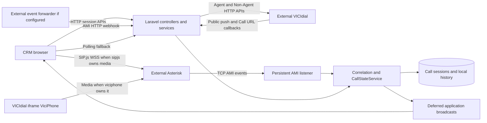

# Telephony boundaries

SIP signaling/media, AMI TCP events, VICIdial HTTP actions, inbound callbacks, and Reverb application events are separate transports. The selected persistent AMI listener processes events in-process; an HTTP AMI webhook is an independent ingress path. An external forwarder is conditional, not asserted to be deployed. Only one browser media owner should be selected. Source: telephony services, AMI command, webhook controllers, webrtc configuration and browser modules.
